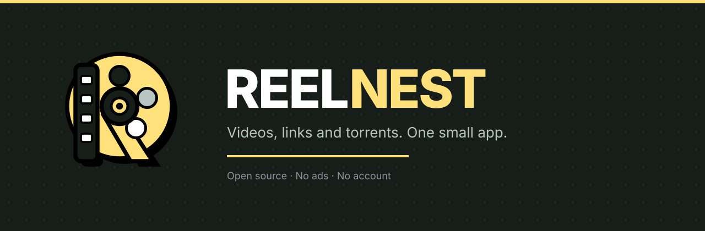

<p align="center">
  
</p>

<p align="center">
  <a href="https://github.com/ShivamRaghuvanshi2006/ReelNest/actions/workflows/ci.yml"></a>
  <a href="https://github.com/ShivamRaghuvanshi2006/ReelNest/releases"></a>
  <a href="https://github.com/ShivamRaghuvanshi2006/ReelNest/releases"></a>
  
  
  
</p>

<h3 align="center">ReelNest: open-source download manager, video downloader and torrent client for Android</h3>

## Table of contents

- [Intro](#intro)
- [Download](#download)
  - [Check the APK is genuine](#check-the-apk-is-genuine)
- [Features](#features)
- [Building from source](#building-from-source)
- [Contributing](#contributing)
- [Disclaimer](#disclaimer)
- [FAQ](#faq)
- [License](#license)
- [Star History](#star-history)

## Intro

ReelNest is a free, open-source download manager for Android. It saves videos from websites (including HLS and m3u8 streams), downloads ordinary links with pause and resume, and works as a torrent client for magnet links and `.torrent` files. It also finds subtitles for the videos you've downloaded.

It replaces a torrent client, a download manager and a video downloader with one small app that has no ads, no tracking and no account. It runs on Android 7 and later, and its source is under the GPL-3.0 licence.

## Download

> [!NOTE]
> ReelNest needs Android 7.0 or later. It is not on Google Play or F-Droid yet, so you install it from GitHub Releases or with Obtainium to get updates automatically.

[](https://github.com/ShivamRaghuvanshi2006/ReelNest/releases/latest)
[](https://apps.obtainium.imranr.dev/redirect?r=obtainium://add/https://github.com/ShivamRaghuvanshi2006/ReelNest)

Each release has four APKs. Pick the one for your phone:

| File | Choose it if |
|---|---|
| `ReelNest-<version>-arm64-v8a.apk` | your phone is from the last six years. Most people want this one. |
| `ReelNest-<version>-armeabi-v7a.apk` | you have an older 32-bit phone. |
| `ReelNest-<version>-x86_64.apk` | you use an emulator or a Chromebook. |
| `ReelNest-<version>-universal.apk` | you aren't sure. It runs on every device. |

The Android package id is still `com.reelnest` so an existing installation can update in place instead of becoming a second app.

### Check the APK is genuine

Release APKs are built by GitHub Actions from this repository. Every release also has a `SHA256SUMS` file listing the SHA-256 hash of every APK in it. Download it next to the APK and run:

```
sha256sum -c --ignore-missing SHA256SUMS
```

It prints `OK` for each file that matches. On Windows, `Get-FileHash <file> -Algorithm SHA256` gives the same hash to compare by hand. The hashes change with every release.

You can also run `apksigner verify --print-certs` on an APK (apksigner comes with the Android SDK build tools) to see which key signed it.

## Features

### Torrents and magnet links
- Open magnet links and `.torrent` files from any app.
- Pick which files to download before you start.
- Keeps going with the screen off, and picks up again if Android closes the app.
- Stop seeding at a ratio or time you choose.

### Download manager for any link
- Paste or share a link to download the file.
- Pause, resume and retry, even after a restart.
- Split a file into several parts that download at once (Parts per download), where the server allows it.
- An expired link asks for a fresh one and carries on where it stopped.

### A browser that saves videos (HLS, m3u8 and DASH)
- Blocks ads and trackers before they load.
- Play a video and ReelNest lists it, along with the page's other files.
- Saves streaming video (HLS and DASH) as one file, at the quality you pick.
- Tabs (swipe the address bar to switch), history and pop-up blocking.
- Downloads that start without a tap go to the tray, pages can't fill your Back history, known crypto-mining scripts are blocked, and pages open over HTTPS when the site supports it.
- Doesn't get around DRM. Netflix-style video, live streams and YouTube-style players can't be saved, and ReelNest says so.

### Subtitles for your videos
- Find subtitles for a video you've downloaded, from 21 free sources, with no account.
- Open a finished link download's menu in Transfers, a torrent's options, or the ⋯ next to a video in its Files tab, then tap **Find subtitles**.
- Results are grouped as "Fits this file", "Probably fits" and "May be out of sync".
- The subtitle is saved next to the video as `<video name>.<lang>.srt` (or `.ass` or `.vtt`), so players pick it up. If one is already there, you choose Replace or Keep both.
- In Settings > Finding things > Subtitle sources you pick and order languages, set a hearing-impaired preference and turn each source on or off. The source list updates itself from ReelNest's signed list.
- Two sources match by file fingerprint: Subtis for Spanish and Napisy24 for Polish. The rest match by name.
- ReelNest sends the video's name to the sources you turn on, and for those two a fingerprint of the file (its size and a hash of its first and last 64 KB). Nothing else, and nothing until you tap Find subtitles.

### Torrent search
- One search box across 40+ public sources, with duplicate results merged.
- A warning on sources known for fake uploads.
- A size range slider hides results that are too small or too big.
- Add your own Jackett or Prowlarr indexer.

### RSS feeds with auto-download
- Follow a show or add any RSS feed, and new episodes download by your rules.

### Assistant (optional)
- Ask in plain words, like "why is this stuck?" or "what's eating my storage?".
- It shows what it wants to do and waits for you to confirm.
- Runs on your own [OpenRouter](https://openrouter.ai) key. Turn it off and the tab disappears.

### You stay in control
- Wi-Fi only, VPN only or charging only, and a pause when the battery runs low.
- Transfers says why a download is held, with a button to change that setting.
- Speed limits and a schedule for when downloads run.
- Files go to `Download/ReelNest`, or any folder you choose.
- Swipe a row in Transfers to pause, resume or remove it, and see a file type icon on each card (a torrent's comes from its biggest file).
- Backup and restore: your settings, search sources, torrents and downloads in one file, and your stats if you tick Include stats. API keys are never included.
- Search your settings from the top of Settings. After an update, a short sheet shows the main new feature.
- OLED, Dim and Light themes.

## Building from source

**Requirements:**

- Node 22
- The Android SDK
- A phone or emulator

You don't need Rust. CI compiles the engine (`libreelnest_core.so`) on every push.

```bash
git clone https://github.com/ShivamRaghuvanshi2006/ReelNest.git && cd ReelNest
npm install --legacy-peer-deps
npx expo run:android
```

Debug builds use a mock engine until the native library is present. For the real engine, download the `jniLibs-<abi>` artifact from a CI run and unpack it into `modules/reelnest-engine/android/src/main/jniLibs/`. ReelNest ships its own native module, so it runs as a development build (`expo run:android`), not in Expo Go.

**Tests:**

```bash
npm test                 # ABI-split plugin + contract suite
npm run test:contracts   # contract suite on its own
npm run test:search      # search providers against offline fixtures
node scripts/test-plugins.js
```

CI also runs the Rust unit tests and checks every engine build for librqbit symbols and 16 KB page alignment.

Subtitle sources are ported from the [Bazarr+](https://github.com/LavX/bazarr-provider-catalog) provider catalog (MIT). Icons are [Pixelarticons](https://github.com/halfmage/pixelarticons) by Gerrit Halfmann (MIT). The browser's built-in block list comes from the [StevenBlack/hosts](https://github.com/StevenBlack/hosts) base list (MIT); rebuild it with `node scripts/build-blocklist.js`.

## Contributing

Bug reports, fixes and ideas are welcome. Read [CONTRIBUTING.md](CONTRIBUTING.md) before you open a pull request. For a new screen, follow [DESIGN.md](DESIGN.md). To report a bug, use **About → Report a bug** in the app, or the [bug report form](https://github.com/ShivamRaghuvanshi2006/ReelNest/issues/new?template=bug.yml). Security problems go through [private reporting](https://github.com/ShivamRaghuvanshi2006/ReelNest/security/advisories/new) (see [SECURITY.md](SECURITY.md)). Everyone taking part follows the [code of conduct](CODE_OF_CONDUCT.md).

Much of ReelNest's code is written by AI agents from specs. Every change is reviewed, and contract tests decide what ships.

## Disclaimer

ReelNest **does not host, store or distribute any content**. Search sends your query to public indexes run by third parties, and the browser talks only to the sites you open and the block-list addresses in Settings. The assistant sends your messages to OpenRouter only when you use it.

What you download, and following the law where you live, is up to you.

## FAQ

### Is ReelNest a 1DM alternative?

Yes. Like 1DM+, ReelNest downloads web links and torrents and has a browser that finds videos on a page. ReelNest is open source and has no ads.

### Is there an open-source download manager for Android?

ReelNest is one. It is free software under the GPL-3.0, and the code is in this repository.

### Can ReelNest download m3u8 or HLS videos?

Yes, on-demand HLS (`.m3u8`) and DASH streams, including HLS with standard AES-128 encryption. ReelNest lists the pieces, lets you pick quality and audio, and joins them into one video file. It refuses DRM-protected video and live streams, and says why.

### Can ReelNest download subtitles?

Yes, for videos you have already downloaded. Tap **Find subtitles** on a finished download, or on a video in a torrent's Files tab. ReelNest searches 21 free sources, with no account, and groups the results by how well they fit the file. The subtitle is saved next to the video, so players pick it up. Two sources match by file fingerprint (Subtis for Spanish, Napisy24 for Polish). The rest match by name, so check the fit. It doesn't fetch subtitles by itself when a download finishes.

### Can ReelNest download torrents and magnet links?

Yes. Open a magnet link or `.torrent` file from any app, pick the files you want, and ReelNest downloads them in the background. It can also search public torrent sources and follow RSS feeds.

### Does ReelNest have ads or tracking?

No. The app has no ads, no analytics SDKs and no account. The built-in browser blocks ads and trackers on the pages you open.

### Can I back up ReelNest and restore it on a new phone?

Yes. In Settings > Backup, export one file with your settings, search sources, torrents and downloads, and your stats if you tick Include stats. API keys are never included. On the new phone, open the file in Settings > Backup and choose what to restore.

### Which Android versions does ReelNest support?

Android 7.0 and later.

## License

ReelNest is free software under the [GNU General Public License v3.0](LICENSE). You can use, study, change and share it. If you distribute a changed version, its source must stay available under the same licence.

It includes a modified copy of [librqbit](https://github.com/ikatson/rqbit) by Igor Katson, under the [Apache License 2.0](native/reelnest-core/vendor/librqbit/LICENSE). The changes are listed in [`REELNEST_PATCH.md`](native/reelnest-core/vendor/librqbit/REELNEST_PATCH.md).

## Star History

<a href="https://www.star-history.com/?repos=ShivamRaghuvanshi2006%2FReelNest&type=date&legend=bottom-right">
 <picture>
   <source media="(prefers-color-scheme: dark)" srcset="https://api.star-history.com/chart?repos=ShivamRaghuvanshi2006/ReelNest&type=date&theme=dark&legend=bottom-right" />
   <source media="(prefers-color-scheme: light)" srcset="https://api.star-history.com/chart?repos=ShivamRaghuvanshi2006/ReelNest&type=date&legend=bottom-right" />
   
 </picture>
</a>
